<div align="center">


</div>

## // lo que construyo

**🌐 Webs** — institucionales, landings de alta conversión y e-commerce. Hiperoptimizadas: la velocidad no es un extra, es el punto de partida. La estrategia UX/UI empieza antes de escribir la primera línea de código.

**📱 Aplicaciones nativas** — de escritorio y móvil, a la medida de tu operación: automatizar procesos, gestionar inventario, llevar tu servicio al bolsillo de tus clientes.

**⚙️ Automatización** — flujos que conectan tus herramientas y eliminan el trabajo manual repetitivo.

Pymes y freelancers de LATAM, pocos proyectos a la vez. No soy una agencia que desaparece tras el pago: soy quien escribe cada línea y responde el chat a las 11pm.

<div align="center">



</div>

## // proyectos destacados

Trabajos entregados a clientes reales. El código es privado, el resultado habla:

| Proyecto | Qué es | Resultado |
|----------|--------|-----------|
| **The English Eagle Academy** | Web institucional | Estrategia UX/UI a medida, carga en milisegundos |
| **Saber Go!** | Landing de alta conversión para SaaS educativo | Diseño pixel-perfect, rendimiento de primer nivel |
| **Automatización de Email** | Trigger events + limpieza de datos con REGEX → Google Sheets | Correos que llegan solos, cero trabajo manual |

➡️ Casos completos y testimonios en [nelson-morales.vercel.app](https://nelson-morales.vercel.app/)

## // contacto

```bash
❯ ./iniciar_proyecto.sh
[ OK ]  Visión recibida
[ OK ]  Estrategia propuesta en 24h
[ OK ]  Código a medida, cero plantillas

→ morales130603@gmail.com
→ https://nelson-morales.vercel.app/
```
